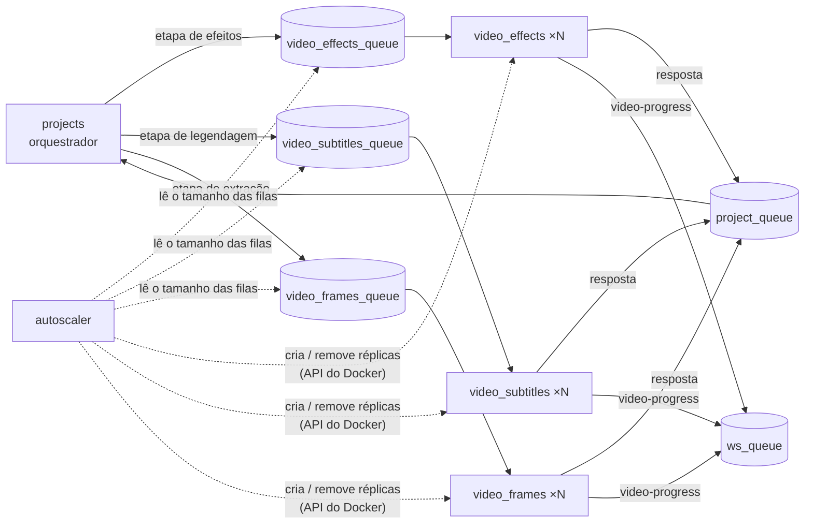

# Desenho da Solução — Fase 2 (ALT-1 + ALT-2)

> **Aprovado pela equipa a 12/11/2026.** Concretiza as decisões D15, D16, D20 e D21 do `CONTEXTO_E_DECISOES_FASE2.md`; as questões de implementação (secção 10) foram decididas em D24–D32. Ainda não implementado.

---

## 1. Objetivo

| Requisito | Fragilidade medida (base) | O que muda |
|---|---|---|
| Eficiência de desempenho — capacidade / elasticidade | Um único `video_tool`, um vídeo de cada vez: um vídeo de 10 s espera 141 s atrás de uma legendagem; débito constante com 1–8 utilizadores; 1 réplica sempre | **ALT-2:** réplicas ajustadas ao tamanho de cada fila por um *autoscaler*; a legendagem tem fila e réplicas próprias |
| Manutenibilidade — modularidade | As 6 responsabilidades de vídeo numa só unidade; mudar a legendagem ou acrescentar um efeito para todo o vídeo | **ALT-1:** três serviços de vídeo (efeitos, legendagem, extração de fotogramas), encadeados pelo `projects` |

## 2. Arquitetura alvo

| | Base | Depois |
|---|---|---|
| Serviços de vídeo | 1 (`video_tool`) | 3 (`video_effects`, `video_subtitles`, `video_frames`) + `autoscaler` |
| Filas de vídeo | 1 (`video_queue`) | 3 (uma por serviço) |
| Mensagens por vídeo | 1, com o pipeline inteiro | 1 por **etapa** (normalmente 1; 2–3 quando há legendas ou extração depois de efeitos) |
| Quem ordena as etapas | O próprio `video_tool` | O `projects`, como já faz nas imagens (D20) |
| Réplicas | 1, fixa | Entre um mínimo e um máximo por serviço, ajustadas à fila: efeitos 1–3, legendagem 1–2, extração de fotogramas 1–2 (D26, configuráveis, D31) |

O padrão global mantém-se: microsserviços com filas no RabbitMQ, orquestração no `projects`, volume partilhado `image_data`, entrada única pelo nginx.

## 3. Os três serviços de vídeo

| Serviço | Responsabilidade | Código de origem (`Tools/video/`) | Dependências da imagem |
|---|---|---|---|
| `video_effects` | Descodificar uma vez, aplicar os efeitos de fotograma (brilho, contraste, …) e de tempo (`trim`, `speed`) e codificar uma vez em MP4/H.264 + AAC | `effects.py`, `_process_video` e auxiliares de `video_processor.py` | ffmpeg, Pillow |
| `video_subtitles` | Reconhecimento de fala (Faster-Whisper) e legendas queimadas no vídeo | `subtitles.py` | ffmpeg, Faster-Whisper, fontes Noto, volume `whisper_models` |
| `video_frames` | Extração de fotogramas (contagem ou intervalo, PNG/JPEG, folha de contacto na pré-visualização) | `frame_extraction.py` | ffmpeg, Pillow |

Cada serviço:
- consome a **sua** fila com `prefetch_count=1` e **confirmação manual no fim** (como o `video_tool`; mantém o REQ-VID-FAIL-004);
- responde para `project_queue` no mesmo formato de hoje (`output.type` = `video`, `frames` ou `image` na pré-visualização);
- envia `video-progress` para `ws_queue`;
- escreve no log a mesma linha de hoje, `[video] msg=… ok frames=… t=XXs` (necessária para a verificação cruzada das medições).

O código comum (ligação ao RabbitMQ, ciclo de consumo, respostas, progresso, `probe`, erros) fica em `Tools/video_common/`, copiado para cada imagem como `Tools/utils/` já é (D25).

## 4. Encadeamento das etapas no `projects` (D20)

### 4.1 Divisão do pipeline em etapas

O `projects` passa a fazer a divisão que hoje o `video_tool` faz internamente em `process_video`, com as **mesmas regras**:

1. Os efeitos de fotograma e de tempo seguidos formam **uma etapa de efeitos** (uma descodificação e uma codificação).
2. Cada `subtitles` é **uma etapa de legendagem**. Se as legendas forem a primeira ferramenta, antes delas há uma etapa de efeitos vazia que normaliza o vídeo para MP4/H.264, como hoje.
3. `extract_frames` é sempre a **última etapa** (regra já validada no `projects`). Se for a única ferramenta, lê diretamente do original, sem recodificar, como hoje.

Exemplos:

| Pipeline do utilizador | Etapas |
|---|---|
| brilho | efeitos[brilho] |
| trim → brilho → legendas | efeitos[trim, brilho] → legendagem |
| legendas → contraste | efeitos[] → legendagem → efeitos[contraste] |
| brilho → extrair fotogramas | efeitos[brilho] → extração |
| extrair fotogramas | extração (do original) |

### 4.2 Execução

- No *Apply*, o `projects` envia **só a primeira etapa** de cada vídeo. O registo `Process` guarda a lista de etapas e a posição atual (`cur_pos`), como já acontece com as ferramentas de imagem.
- Quando chega a resposta de uma etapa (`project_queue`), se não for a última, o `projects` cria o `Process` seguinte e envia a etapa seguinte, com o resultado anterior como entrada. Na última etapa, o tratamento é o de hoje (gravar o `Result`, ou os fotogramas, e avisar o utilizador com `process-update`).
- **Ficheiros intermédios** ficam no volume partilhado `image_data` (QI-6), numa pasta temporária do projeto, e são apagados no fim, em erro ou em cancelamento. Só a última etapa produz um resultado visível: continua a não haver saídas parciais.
- **Erros:** uma etapa que falhe responde com erro, como hoje; o `projects` avisa o utilizador e não envia as etapas seguintes.
- **Cancelamento:** o controlo atual por *token* (`activeToken`) aplica-se a cada etapa: uma resposta de uma execução cancelada é ignorada e a cadeia para.
- **Pré-visualização** (3 s): segue as mesmas etapas. O corte para os 3 s faz-se na última etapa de efeitos que tenha `trim`/`speed` (ou na primeira, se não houver), como hoje em `preview_stage`.

### 4.3 Progresso

Cada mensagem leva a etapa e o número de etapas; o serviço converte o progresso da sua etapa numa percentagem do total, com a fórmula de hoje: `(etapa + pct/100) × 100 / n.º de etapas` (QI-5). O utilizador continua a ver uma única barra de 0 a 100 %.

## 5. *Autoscaler* (D21)

Serviço novo, `autoscaler` (Python, pequeno):

1. A cada intervalo (QI-3), lê na API de gestão do RabbitMQ (`http://rabbitmq:15672`, rede interna) as mensagens prontas e em processamento de cada fila de vídeo.
2. Calcula as réplicas desejadas de cada serviço: `desejadas = limitar(ceil(mensagens / mensagens_por_réplica), mínimo, máximo)` (QI-2, QI-3).
3. **Sobe** logo que `desejadas > atuais`. **Desce** só depois de a fila estar abaixo do limiar durante um período de espera (*cooldown*), para não oscilar.
4. Cria ou remove réplicas pela API do Docker (QI-4). Cada réplica tem os mesmos *labels* do Compose (`com.docker.compose.project`, `com.docker.compose.service`), por isso aparece no Docker Desktop e no monitor das medições como réplica do serviço, e é removida por `docker compose down`.
5. Ao remover uma réplica, pára-a de forma graciosa (`SIGTERM`): uma mensagem a meio volta à fila (confirmação manual), sem perda de trabalho.
6. Escreve no log cada decisão (`fila`, `mensagens`, `réplicas atuais → desejadas`), que serve de evidência no S3.

**Efeito colateral (segurança):** o `autoscaler` precisa do *socket* do Docker (`/var/run/docker.sock`), o que lhe dá controlo sobre todos os contentores da máquina. Mitigações: só ele o monta, sem portas publicadas, só atua em contentores com o *label* do projeto `picturas`. Fica registado no relatório como *trade-off* entre elasticidade e segurança.

## 6. O que fica igual (preservação funcional)

- API pública (`/api-gateway/...`), frontend e eventos WebSocket (`video-progress`, `process-update`, `process-error`).
- Formato das mensagens de resposta para `project_queue` e dos resultados (MP4/H.264 + AAC; fotogramas como `Result` de imagem com nome único; pré-visualização de 3 s; folha de contacto na extração).
- Regras de vídeo do `README.md`/`AGENTS.md` (ferramentas só de vídeo, `trim`/`speed` por vídeo, extração terminal e única, limites por perfil, cada efeito conta 1 operação).
- Caminho das imagens: as ferramentas de imagem e a sua cadeia não mudam.
- Os 82 testes da base (`Tools/video/tests`, `projects/tests`) continuam a passar; os de `Tools/video/tests` mudam de pasta com o código que testam, sem mudar o que verificam (QI-7).

## 7. Ficheiros a alterar (estimativa)

| Área | Alteração |
|---|---|
| `Tools/` | `video/` dividido em `video_effects/`, `video_subtitles/`, `video_frames/` e código comum (QI-1); um `Dockerfile` por serviço; `autoscaler/` novo |
| `projects/utils/video.js` | Função nova de divisão em etapas (4.1) |
| `projects/utils/project_msg.js` | Mapeamento das etapas para as três filas novas |
| `projects/routes/projects.js` | *Apply*, pré-visualização e tratamento das respostas: enviar a etapa seguinte em vez de terminar |
| `projects/models/` | `Process` com a lista de etapas |
| `rabbitMQ/definitions.json` | Três filas novas (e `video_queue` removida) |
| `docker-compose.yaml` | Três serviços de vídeo + `autoscaler` em vez do `video_tool` |
| `projects/tests`, testes dos serviços | Testes novos da divisão em etapas; testes atuais mudados de pasta |
| `README.md`, `AGENTS.md` | Arquitetura e operação atualizadas |
| Medição final | `--servico-legendas video_subtitles` (M3); `--servicos-log video_effects video_subtitles video_frames projects` |

## 8. Efeitos colaterais e riscos

| Efeito | Atributo afetado | Como se avalia |
|---|---|---|
| Etapas extra com ficheiros intermédios quando há legendas ou extração depois de efeitos | Comportamento temporal | S4 (só efeitos: sem diferença esperada) e tempo da legendagem em S1 |
| Mais réplicas = mais memória (legendagem ≈ 1 GB por réplica) | Utilização de recursos | S3 (memória por contentor); limites por serviço (QI-8) |
| `autoscaler` com acesso ao Docker | Segurança | Registado como *trade-off*; mitigações da secção 5 |
| Atraso de arranque de uma réplica nova (alguns segundos) | Comportamento temporal | S2/S3; mínimo de réplicas (QI-2) |
| Lógica de etapas passa para o `projects` (já com 2 732 linhas) | Modularidade do orquestrador | M2 (tamanho e ramos de vídeo do `projects`) |

## 9. Correção necessária à quantificação do M1 e do M2

Ao desenhar os serviços ficou claro que a escala aprovada para o M1 e o M2 (D22) **não é atingível por construção**. Ela conta 6 "responsabilidades" técnicas detetadas no código, e duas delas existem obrigatoriamente em **todos** os serviços de vídeo: **consumir trabalhos da fila** e **codificar com ffmpeg**. Assim, mesmo com a divisão em três serviços:

- o `video_effects` fica com 4 (consumir, efeitos de fotograma, efeitos de tempo, codificar), acima do alvo M2 ≤ 2;
- o C1 (mudar a legendagem) reinicia o `video_subtitles` e interrompe 3 (consumir, codificar, legendagem), acima do alvo M1 = 1.

**Decidido (D24):** medir o M1 e o M2 em **funcionalidades de vídeo**, as que o utilizador vê: **edição** (efeitos de fotograma e de tempo), **legendagem** e **extração de fotogramas**. Consumir da fila e codificar passam a ser infraestrutura comum, não funcionalidades. A escala aplica-se igualmente à base (recalculada a partir dos mesmos dados, sem medir de novo):

| Métrica | Base | Alvo | Mínimo aceitável |
|---|---|---|---|
| M2 — funcionalidades de vídeo numa unidade implantável | 3 | 1 | ≤ 2 |
| M1 — funcionalidades interrompidas por uma mudança na legendagem (C1, C2) | 3 | 1 | ≤ 2 |

## 10. Questões de implementação (todas decididas a 12/11/2026)

| Questão | Decisão |
|---|---|
| QI-0 Escala do M1 e do M2 | (a) funcionalidades de vídeo — D24 |
| QI-1 Código comum | (a) `Tools/video_common/` — D25 |
| QI-2 Réplicas | (a) efeitos 1–3, legendagem 1–2, extração de fotogramas 1–2 — D26 |
| QI-3 Regra do *autoscaler* | (a) 1 por mensagem, 2 s, descer após 30 s — D27 |
| QI-4 Como muda as réplicas | (a) API do Docker, clonando a réplica — D28 |
| QI-5 Progresso | (a) uma barra de 0 a 100 % no total — D29 |
| QI-6 Ficheiros intermédios | (a) volume `image_data` — D30 |
| QI-7 Testes atuais | (a) mudam de pasta com o código — D30 |
| QI-8 Memória e réplicas | configuráveis por variáveis de ambiente, com valores por omissão — D31 |
| Q12 Teste de ponta a ponta | (b) sim, com o cliente das medições — D32 |

Opções que foram consideradas:

| ID | Questão | Opções | Recomendação |
|---|---|---|---|
| **QI-0** | Corrigir a escala do M1 e do M2 (secção 9)? | (a) contar funcionalidades de vídeo (3); (b) manter as 6 responsabilidades e baixar os alvos (M2 ≤ 4, M1 ≤ 3); (c) manter tudo como está | (a) |
| **QI-1** | Onde fica o código comum dos serviços de vídeo? | (a) `Tools/video_common/` copiado para cada imagem, como `Tools/utils/` já é; (b) uma só pasta `Tools/video/` com três pontos de entrada e três Dockerfiles; (c) código duplicado em cada serviço | (a) |
| **QI-2** | Réplicas mínimas e máximas por serviço (8 CPU, 6 GB) | (a) efeitos 1–3, legendagem 1–2, extração de fotogramas 1–2; (b) efeitos 2–4, legendagem 1–2, extração 1–2; (c) mínimo 0 (escalar a zero) com os mesmos máximos de (a) | (a) |
| **QI-3** | Regra de escalonamento | (a) 1 réplica por mensagem na fila, leitura a cada 2 s, descer após 30 s abaixo do limiar; (b) 1 réplica por cada 2 mensagens, leitura a cada 5 s, descer após 60 s; (c) subir só com ≥ 3 mensagens à espera | (a) |
| **QI-4** | Como o `autoscaler` cria e remove réplicas | (a) API do Docker (SDK Python), clonando a configuração da réplica existente; (b) `docker compose up --scale` dentro do contentor (precisa do `docker-compose.yaml` montado); (c) Docker Swarm (`deploy.replicas`) | (a) |
| **QI-5** | Progresso com várias etapas | (a) cada etapa converte o seu progresso numa percentagem do total (fórmula de hoje); (b) a barra recomeça em cada etapa | (a) |
| **QI-6** | Onde ficam os ficheiros intermédios entre etapas | (a) volume partilhado `image_data`, como hoje; (b) SeaweedFS | (a) |
| **QI-7** | Testes de `Tools/video/tests` | (a) mudam de pasta com o código, sem mudar o que verificam, mais testes novos da divisão em etapas; (b) ficam onde estão, a importar dos novos serviços | (a) |
| **QI-8** | Limites de memória por serviço no `docker-compose.yaml` | (a) sim (ex.: legendagem 1,5 GB, efeitos 1 GB, extração 512 MB); (b) não | (a) |
| **Q12** | Teste de ponta a ponta (imagem + vídeo pela API), antes e depois | (a) não; (b) sim, com o cliente dos scripts de medição; (c) testes unitários novos do `projects` | (b) |
