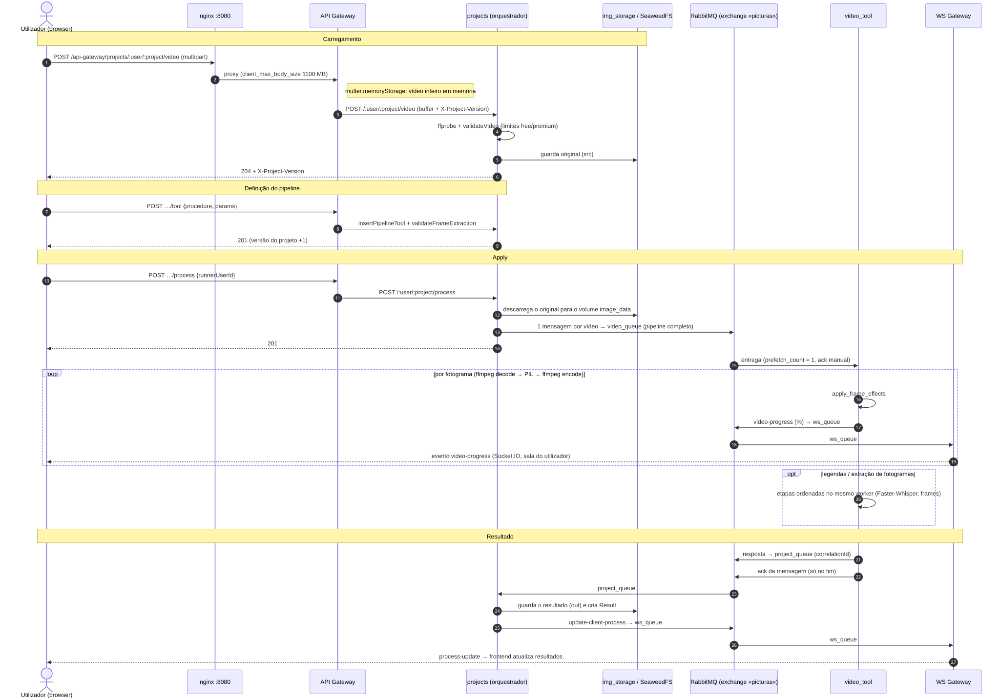

# 📝 Exercício 6 (Bloco 1) — Identificação e Comparação de Padrões Arquiteturais
### Fase 2: Melhoria de Requisitos Não Funcionais do PictuRAS

> **RASCUNHO para revisão da equipa** (proposto pelo agente de IA a 11/11/2026, a partir do código, da configuração e da medição inicial completa, terminada às 15:56). Os pontos marcados com ⚠️ dependem de uma decisão da equipa.

---

**Equipa:** PL5-G7  
**Elementos:** PG63958 Francisco Dias · PG65437 Rodrigo Rocha · PG64026 Rodrigo Fernandes · PG65424 Luís Miguel · PG63986 Joaquim Cunha  
**Commit de partida:** `0523102` (`git rev-parse HEAD` em `picturas-um/picturas-27`: `052310226c51fa57a17101c7bd1ad795674aac95`; código igual a `b638a13`, só acrescenta documentação)  
**Data da análise:** 2026-11-11  
**Versão deste documento:** v0.2 (rascunho, com a medição inicial)  
**Versões usadas:** enunciado 1.1 · template 1.1

---

## 0. Preparação e ambiente

| **Item** | **Valor** |
|----------|-----------|
| Commit de partida | `0523102` |
| Comando(s) de arranque | Limpeza dos dados da instância (`docker compose down --remove-orphans` e remoção dos volumes de dados, mantendo `picturas_whisper_models`), depois `docker compose up -d --build`. Automatizado em `Documentacao/medicoes/medicao_inicial.command` (lógica em `lancar_medicao.sh`) |
| Ambiente (SO, CPU, RAM, versões de Docker e Compose) | macOS, `Mac14,7` (MacBook Pro 13", 2022), Apple M2, 8 núcleos, 8 GiB; Docker 29.8.0 com 8 CPU, 6 GB de memória e 1 GB de swap atribuídos; Python 3.13.7 para os scripts de medição. Registo completo em `Documentacao/medicoes/baseline/ambiente.json` |
| Projeto de teste (nº de imagens e de vídeos, amostras usadas) | ⚠️ Projeto misto (imagens + vídeos) a criar na aplicação para as capturas. Nas medições: um vídeo por projeto (`samples/video/sample_10s_720p.mp4`, `speech_mandela_177s_1080p.webm`, e `02_curto_720p_30s.mp4` e `01_demo_1080p_150s.mp4` em `Documentacao/medicoes/videos/`) |
| Problemas encontrados ao lançar | (1) O nome de projeto Compose (`picturas`) é o mesmo da Fase 1: os volumes antigos têm de ser apagados antes do primeiro arranque (aviso do commit `0523102`). (2) O primeiro `--build` descarrega e instala as dependências de ~30 imagens (≈ 8 min nesta máquina) e ocupa vários GB. (3) Nenhum outro problema: API disponível às 14:31, todos os serviços `Up` |

**Como é orquestrado o processamento em lote de imagens e de vídeos:**

No *Apply*, o frontend chama `POST …/process`; o `projects` valida o pipeline e, para cada media do projeto, descarrega o original do SeaweedFS para o volume partilhado `image_data` e publica uma mensagem no RabbitMQ (EV-06). Para uma **imagem**, a mensagem leva só a **primeira** ferramenta de imagem e vai para a fila dessa ferramenta (`<tool>_queue`); cada resposta chega a `project_queue` e o `projects` publica a ferramenta seguinte (`cur_pos + 1`) até ao fim da cadeia (EV-05, EV-07). Para um **vídeo**, o `projects` envia **uma só mensagem** para `video_queue` com o **pipeline inteiro** (`videoPipeline`), que o `video_tool` aplica numa passagem: descodifica, aplica os efeitos fotograma a fotograma, executa as etapas de legendagem/extração e codifica uma vez (EV-08, EV-11). O sistema distingue os dois tipos pelo campo `media_type` do media (`isVideoMedia`), definido no carregamento por endpoints separados (`…/img` e `…/video`). O progresso do vídeo vai do worker para `ws_queue` e daí, pelo WS Gateway, para o browser (EV-19).

---

## 1. Âmbito e vista da arquitetura

### 1.1 Fontes consultadas

| **Fonte** | **Versão / data** | **Usada para** |
|-----------|-------------------|----------------|
| `README.md` | `0523102` | Arranque, serviços, regras da legendagem e da extração de fotogramas |
| `AGENTS.md` | `0523102` | Regras de vídeo (ferramentas só de vídeo, por vídeo, terminal), limites por perfil |
| `doc-ext-requisitos-2627.pdf` | PL1-G4, 23/10/2026 | Requisitos não funcionais de vídeo (Tabela 30), manutenção corretiva pendente, decisões (DQ-01 a DQ-07) |
| `doc-sol-arquitetural.pdf` | Fase 2 de 2025/2026 (jan. 2026) | Solução de base anterior (T-01 a T-11, RNF46–RNF66) |
| Diretrizes da Fase 2 | Versão 1, 4/11/2026 | Âmbito, ideias indicativas, princípios |
| Slides da aula 11 (*Arch. Styles*) | JM Fernandes | Estilos: *pipe & filter*, *batch-sequential*, *publish-subscribe*, *client-server* |
| `RAS_support_doc_architectural_patterns_PT.md` | Exercício 6 | Catálogo de padrões e níveis de análise |
| `arquitetura_global.puml` | Equipa docente, 5/11/2026 | Vista da arquitetura global (secção 1.2) |
| Código e configuração | `0523102` | Evidências EV-01 a EV-21, EV-24, EV-25 |
| Medição inicial | `Documentacao/medicoes/baseline/` (11/11/2026) | Evidências medidas (EV-22, EV-23, EV-26 a EV-30) |

### 1.2 Vista da arquitetura global

> ⚠️ Q9 por decidir: usar a vista dos docentes tal como está, adaptá-la ou fazer uma nossa. Até lá usa-se a vista dos docentes, com citação.

**Ferramenta / notação:** PlantUML, diagrama de componentes (fonte: `arquitetura_global.puml`, equipa docente).

| **Elemento (cor, forma ou estilo)** | **Significado** |
|-------------------------------------|-----------------|
| Seta laranja grossa | Caminho do vídeo |
| Seta cinzenta | Padrão global / caminho de imagens |
| Linha azul tracejada | Acesso ao volume partilhado `image_data` |
| Componente laranja | `video_tool` (worker único) |
| Pacote amarelo | RabbitMQ: exchange direto `picturas` e filas duráveis |

### 1.3 Diagrama de sequência de um pedido completo

(Fonte: `sequencia_processamento_video.mmd`, Mermaid.)

| **Passo** | **Origem → Destino** | **Mensagem / endpoint / fila** | **Evidência** |
|-----------|----------------------|--------------------------------|---------------|
| Carregamento do vídeo | Browser → nginx → API Gateway → `projects` → `img_storage`/SeaweedFS | `POST /api-gateway/projects/:user/:project/video` (multipart, buffer em memória no gateway e no `projects`) | EV-01, EV-15, EV-08 |
| Definição do pipeline | Browser → API Gateway → `projects` | `POST …/tool {procedure, params}` com `X-Project-Version`; `insertPipelineTool` mantém a extração no fim | EV-08 |
| *Apply* | Browser → API Gateway → `projects` → RabbitMQ → `video_tool` | `POST …/process`; 1 mensagem por vídeo em `video_queue` com o pipeline inteiro | EV-06, EV-09 |
| Progresso | `video_tool` → `ws_queue` → WS Gateway → browser | Evento `video-progress` (percentagem) para a sala do utilizador | EV-19 |
| Resultado | `video_tool` → `project_queue` → `projects` → SeaweedFS; `projects` → `ws_queue` → browser | Resposta com `correlationId`; `Result` gravado; evento `process-update` | EV-07, EV-19 |

### 1.4 Onde e porquê o sistema bifurca entre imagem e vídeo

| **Ponto de bifurcação** | **Caminho de imagens** | **Caminho de vídeo** | **Evidência** | **Porquê** (facto ou hipótese) |
|-------------------------|------------------------|----------------------|---------------|--------------------------------|
| Carregamento | `POST …/img` | `POST …/video`, com `ffprobe`, validação de codec, duração, tamanho e resolução por perfil | EV-08 | Facto: cada endpoint recusa o outro tipo; os limites de vídeo dependem do perfil (free 60 s / 100 MB, premium 600 s / 1 GB) |
| Validação do pipeline no *Apply* | `imageTools(project)` (ignora as ferramentas só de vídeo) | `unsupportedVideoTools` recusa efeitos sem versão de vídeo (IA, marca de água) | EV-06, EV-08 | Facto: o vídeo só tem os efeitos implementados no `video_tool` |
| Despacho | 1 mensagem por (imagem, ferramenta), para a fila da ferramenta | 1 mensagem por vídeo, para `video_queue`, com o pipeline todo | EV-06 | Facto (código); a justificação do PL1-G4 é descodificar e codificar uma só vez e não deixar saídas parciais (DQ-04/DQ-06) |
| Avanço da cadeia | `projects` publica a ferramenta seguinte (`cur_pos + 1`) | `chainEnd = sourceIsVideo …`: a resposta do vídeo é sempre a última | EV-07 | Facto |
| Confirmação da mensagem | `auto_ack=True` ao receber | Ack manual no fim do processamento | EV-09, EV-10 | Facto; o PL1-G4 mudou o vídeo para ack manual para não perder trabalho (DQ-06) |
| Interface | Todas as ferramentas | Em projetos com vídeo, o frontend esconde as ferramentas de IA e a marca de água e mostra Legendas e Extrair fotogramas | EV-18 | Facto |

---

## 2. Identificação e análise dos padrões atuais

### 2.1 Padrão global da solução

| | |
|---|---|
| **Nome(s) do padrão / estilo** | **Microsserviços com API Gateway**, comunicação **Event-Driven / Work Queue** sobre RabbitMQ, **orquestração centralizada** no `projects`, e **pipeline distribuído** (*Pipes and Filters* distribuído / *batch-sequential* entre serviços) no processamento de imagens; **Layered** dentro de cada serviço Node |
| **Descrição** | Entrada única por nginx (TLS) que encaminha para o frontend, o API Gateway (REST, JWT) e o WS Gateway (Socket.IO). Serviços de negócio com base de dados própria (`users`, `projects`, `subscriptions`). O `projects` orquestra o processamento: publica trabalhos em filas, uma por ferramenta, e avança a cadeia a cada resposta. Cada ferramenta de imagem é um contentor que consome a sua fila. Os ficheiros passam entre serviços pelo volume partilhado `image_data` e pelo SeaweedFS |

**Decisões globais que condicionam o vídeo**

| **Decisão global** | **Evidência** | **Efeito no vídeo** |
|--------------------|---------------|---------------------|
| Entrada única por nginx com limite de corpo de 1100 MB | EV-01 | Um vídeo de até 1 GB atravessa nginx → gateway → `projects` → `img_storage` |
| Carregamento com `multer.memoryStorage` no gateway, no `projects` e no `img_storage` | EV-15 | Um vídeo grande fica inteiro em memória em três serviços |
| Comunicação assíncrona por filas duráveis num exchange direto (`picturas`), uma fila por tipo de trabalho | EV-04, EV-05 | O vídeo ganha uma fila própria (`video_queue`) e reutiliza `project_queue` e `ws_queue` |
| Orquestração central no `projects` (cadeia de ferramentas, `Process`/`Result`, tokens de execução) | EV-06, EV-07, EV-21 | A lógica de vídeo (validação, limites, despacho, resultados, extração) entra no mesmo serviço, ramificando o código |
| Volume partilhado `image_data` entre o `projects` e todas as ferramentas | EV-24 | O `video_tool` lê e escreve os ficheiros no mesmo volume |
| Implantação com Docker Compose, 1 contentor por serviço, sem réplicas nem limites de recursos | EV-03 | O `video_tool` é um único contentor; não há mecanismo de escalonamento |
| Imagens Docker construídas com contexto `./Tools` e biblioteca comum `Tools/utils` | EV-25 | O `video_tool` partilha a biblioteca de mensagens com as ferramentas de imagem |

**Benefícios e desafios do padrão global**

| **Tipo** | **Descrição** | **Característica / subcaracterística (ISO/IEC 25010)** | **Facto / hipótese** |
|----------|---------------|--------------------------------------------------------|----------------------|
| Benefício | Cada ferramenta de imagem é independente: acrescentar uma é criar um serviço e uma fila, sem tocar nas outras | Manutenibilidade — modularidade, modificabilidade | EV-03, EV-05 |
| Benefício | As filas desacoplam o pedido HTTP do processamento: o *Apply* responde logo e o trabalho continua em segundo plano | Eficiência — comportamento temporal; Usabilidade — operabilidade | EV-06 |
| Benefício | Cada ferramenta tem a sua fila, por isso uma ferramenta lenta não bloqueia as outras | Eficiência — capacidade | EV-04 |
| Benefício | Entrada única com TLS e JWT no gateway | Segurança — autenticidade | EV-01, EV-02 |
| Desafio | Orquestrador central muito grande (`projects/routes/projects.js` com 2 732 linhas e 33 rotas) e com ramos imagem/vídeo | Manutenibilidade — modularidade, analisabilidade | EV-21, EV-23 |
| Desafio | Recursos fixos: 1 contentor por serviço, sem réplicas nem limites | Eficiência — capacidade | EV-03 |
| Desafio | As ferramentas de imagem confirmam a mensagem ao recebê-la: uma falha a meio perde o trabalho; as respostas de erro trocam `messageId` e `correlationId` | Fiabilidade — tolerância a falhas | EV-10, EV-20; perda de trabalho: H-06 |
| Desafio | Confiança implícita entre serviços: `rejectUnauthorized: false` em 7 ficheiros, certificados internos expirados, segredos no `docker-compose.yaml`, 12 portas publicadas além do nginx | Segurança — confidencialidade, autenticidade | EV-16, EV-17, EV-03 |
| Desafio | Ficheiros passam pelo volume partilhado e são copiados entre etapas (cada ferramenta escreve a imagem completa) | Eficiência — utilização de recursos | EV-24 |

### 2.2 Padrão do processamento de vídeo

| | |
|---|---|
| **Nome do padrão** | **Worker único sobre uma fila** (*pipeline monolith* dentro de uma arquitetura de microsserviços), com **pipeline completo numa só mensagem**; internamente, *pipe & filter* por fotograma (ffmpeg → PIL → ffmpeg) e *batch-sequential* entre etapas (legendagem e extração escrevem ficheiros intermédios `stage-N.mp4`) |
| **Descrição** | O `projects` envia uma mensagem por vídeo com a sequência ordenada de efeitos. O `video_tool` (um contentor, `prefetch_count=1`, ack manual no fim) descodifica o vídeo uma vez, aplica os efeitos de fotograma (PIL, duplicados das ferramentas de imagem) e de tempo (`trim`, `speed`), corre a legendagem (Faster-Whisper em CPU) e a extração de fotogramas como etapas ordenadas, codifica uma vez para MP4/H.264 + AAC e envia o progresso para `ws_queue` |
| **Contraste com o caminho de imagens** | Imagens: um serviço por ferramenta e uma mensagem por (imagem, ferramenta), com o `projects` a avançar a cadeia (pipeline distribuído, *batch-sequential* entre serviços). Vídeo: um serviço para todos os efeitos e uma mensagem por vídeo (pipeline numa só unidade). Nos slides da aula 11, o caminho de imagens está mais perto de *batch-sequential* (etapas grossas, cada uma escreve a saída completa) e o interior do `video_tool` mais perto de *pipe & filter* (fotogramas a fluir entre filtros) |

**Benefícios e desafios do padrão do vídeo**

| **Tipo** | **Descrição** | **Característica / subcaracterística (ISO/IEC 25010)** | **Facto / hipótese** |
|----------|---------------|--------------------------------------------------------|----------------------|
| Benefício | Descodifica e codifica uma só vez, em vez de uma vez por efeito | Eficiência — comportamento temporal, utilização de recursos | EV-11; tempo ≈ 1× a duração do vídeo (EV-22) |
| Benefício | Sem saídas parciais: o resultado só é gravado no fim; com ack manual, uma falha do worker devolve a mensagem à fila | Fiabilidade — tolerância a falhas, recuperabilidade | EV-09; retoma após falha confirmada: 5/5 legendagens concluídas depois de o worker ser terminado (EV-29) |
| Benefício | Uma só mensagem por vídeo simplifica o orquestrador para o vídeo (sem avançar cadeia) | Manutenibilidade — modificabilidade | EV-07 |
| Desafio | Um consumidor, `prefetch_count=1`, sem réplicas: os vídeos de todos os utilizadores são processados um de cada vez | Eficiência — capacidade | EV-03, EV-09; débito constante de 16–18 vídeos/min de 1 a 8 utilizadores, nunca mais de 1 vídeo em processamento (EV-27) |
| Desafio | A legendagem (Whisper em CPU, 2 threads) corre no mesmo worker e ocupa-o durante minutos | Eficiência — capacidade, comportamento temporal | EV-13; legendagem do vídeo de 177 s em 142 s (mediana); um vídeo de 10 s passa de 3,9 s para 144,7 s quando pedido durante uma legendagem (EV-26) |
| Desafio | Todas as responsabilidades de vídeo (6) numa única unidade implantável: mudar a legendagem obriga a reconstruir e reiniciar o serviço que faz todos os vídeos | Manutenibilidade — modularidade, modificabilidade | EV-23 (M2, M1) |
| Desafio | Os 8 efeitos de fotograma estão duplicados (`Tools/video/effects.py` e as 8 ferramentas de imagem) | Manutenibilidade — modificabilidade, reutilização | EV-12, EV-23 |
| Desafio | `heartbeat=0`: o broker não deteta um worker bloqueado | Fiabilidade — disponibilidade | EV-09; H-07 |
| Desafio | Processamento fotograma a fotograma em Python, num só processo | Eficiência — utilização de recursos | EV-11; H-08 |

### 2.3 Relação entre o padrão global e o padrão do vídeo

| **Aspeto** | **O que o padrão global prescreve** | **O que o vídeo faz** | **Segue / afasta-se** | **Consequência** | **Evidência** |
|------------|-------------------------------------|-----------------------|-----------------------|------------------|---------------|
| Entrada e autenticação | nginx + API Gateway com JWT | Igual | Segue | Herda a segurança da entrada e as suas fragilidades (carregamento em memória) | EV-01, EV-02, EV-15 |
| Comunicação | Filas no RabbitMQ, uma por tipo de trabalho | Fila própria `video_queue`; reutiliza `project_queue` e `ws_queue` | Segue | Desacoplamento e persistência das mensagens | EV-04, EV-09 |
| Granularidade dos serviços | Um serviço por ferramenta | Um serviço para todos os efeitos, legendagem e extração | Afasta-se | Menos serviços e uma só descodificação, mas menor modularidade e impossibilidade de escalar cada etapa à parte | EV-03, EV-11, EV-23 |
| Orquestração | `projects` avança a cadeia ferramenta a ferramenta | Uma mensagem com o pipeline todo; o worker orquestra as etapas internamente | Afasta-se | A ordem dos efeitos passa a estar em dois sítios (`projects` e `video_processor`) | EV-07, EV-08, EV-11 |
| Confirmação das mensagens | `auto_ack` nas ferramentas de imagem | Ack manual no fim | Afasta-se (para melhor) | O vídeo não perde trabalho se o worker cair; as imagens perdem | EV-09, EV-10 |
| Implantação e recursos | 1 contentor por serviço, recursos fixos | 1 contentor, sem réplicas, `prefetch_count=1` | Segue | Herda a falta de escalonamento; no vídeo o efeito é maior porque os trabalhos duram minutos | EV-03, EV-09 |
| Armazenamento | Volume `image_data` + SeaweedFS | Igual | Segue | Herda o acoplamento ao volume partilhado | EV-24 |

**O que o vídeo herda do padrão global / que restrições este lhe impõe / que fragilidades resultam do desvio:**

O vídeo herda a entrada única, a autenticação, o desacoplamento por filas duráveis e o armazenamento partilhado. O padrão global impõe-lhe a orquestração no `projects` (que obriga a ramificar o orquestrador entre imagem e vídeo) e uma implantação com recursos fixos. Ao concentrar todos os efeitos num worker único, o vídeo afasta-se da decomposição por ferramenta: ganha uma só descodificação e resultados sem saídas parciais, mas perde a independência entre efeitos e a possibilidade de escalar cada um. Esta combinação explica as duas fragilidades centrais: a legendagem, a etapa mais pesada, bloqueia todos os outros vídeos (capacidade), e qualquer mudança num efeito afeta o serviço inteiro (modularidade).

### 2.4 Legendagem automática e extração de fotogramas

| **Funcionalidade** | **Como se integra no padrão do vídeo** | **Impacto nos atributos de qualidade** | **Evidência** |
|--------------------|----------------------------------------|-----------------------------------------|---------------|
| Legendagem automática | Etapa ordenada dentro do `video_tool` (`process_video` divide o pipeline em etapas; a legendagem escreve um ficheiro intermédio e a etapa seguinte lê-o). Faster-Whisper `small`, CPU/int8, 2 threads; modelo no volume `whisper_models`. Só vídeo, para todo o projeto | **Capacidade e comportamento temporal:** ocupa o único worker durante cerca de 0,7× a duração do vídeo nesta máquina (126 s para 177 s), atrasando os outros vídeos (EV-26: atraso mediano de 141 s num vídeo de 10 s). **Modularidade:** acrescenta uma dependência pesada (Whisper, fontes) à imagem de todos os efeitos. **Utilização de recursos:** CPU limitado a 2 threads, independentemente da carga | EV-11, EV-13, EV-22, EV-23 |
| Extração de fotogramas | Etapa terminal e única dentro do `video_tool`; o `projects` valida a posição (`validateFrameExtraction`, `insertPipelineTool`) e grava cada fotograma como um `Result` de imagem | **Modificabilidade:** a regra "último passo" vive em três sítios (frontend, `projects`, worker). **Adequação funcional:** sem efeitos antes, lê do original sem recodificar. **Capacidade:** partilha o mesmo worker | EV-08, EV-14 |

### 2.5 Suporte aos requisitos não funcionais existentes e regras sem requisito explícito

| **Requisito / regra** | **Padrão global suporta?** | **Padrão do vídeo suporta?** | **Porquê** | **Evidência** |
|-----------------------|----------------------------|------------------------------|------------|---------------|
| REQ-VID-EDIT-010 — editar em até 1× a duração (MVP 5×) | Sim | Sim | Uma descodificação e uma codificação; medido (mediana): 0,39× (10 s, 720p), 0,38× (30 s, 720p), 0,90× (150 s, 1080p), sozinho | EV-11, EV-22 |
| REQ-VID-EDIT-011 — vários vídeos em paralelo (capacidade; MVP ≥ 2) | Parcial | Não | Um consumidor com `prefetch_count=1` e sem réplicas; medido: no máximo 1 vídeo em processamento | EV-03, EV-09, EV-27 |
| REQ-VID-STATUS-003 — progresso a cada 2 s ou menos | Sim | Sim | Evento `video-progress` por cada 2 % do vídeo | EV-19 |
| REQ-VID-FAIL-004 — sem perda de trabalho após falha interna | Parcial (imagens com `auto_ack`) | Sim (ack manual) | A mensagem volta à fila se o worker cair antes do ack; medido: 0 trabalhos perdidos em 5 falhas provocadas | EV-09, EV-10, EV-29 |
| REQ-VID-EDIT-012 — taxa de sucesso ≥ 99,5 % | Por medir | Por medir | Não medida pelo PL1-G4 | — |
| REQ-VID-SUBMIT-008 — aceitação do upload em < 1 s | Não | Não | Carregamento inteiro em memória em três serviços antes da resposta | EV-15; H-05 |
| REQ-VID-EDIT-013 — acrescentar um efeito sem alterar os outros | Sim (imagens) | Parcial | Medido com a sonda C3: 6 ficheiros em 3 componentes, incluindo o ficheiro dos efeitos existentes, e reinício do único worker | EV-08, EV-12, EV-31 |
| REQ-VID-EDIT-014 — edição só com componentes isolados no serviço | Sim | Sim | ffmpeg e Whisper dentro da imagem do `video_tool` | EV-25 |
| Sem requisito explícito: extração de fotogramas sempre o último passo e no máximo uma vez | — | Sim | Validada no `projects` e reforçada na inserção | EV-08 |
| Sem requisito explícito: legendagem só para vídeo, para todo o projeto, na ordem do pipeline | — | Sim | `VIDEO_ONLY_TOOLS`; etapa ordenada no worker | EV-08, EV-11 |
| Sem requisito explícito: no máximo 100 fotogramas por vídeo; intervalo que daria mais é recusado | — | Sim | `validateFrameExtraction` e `frame_extraction.validate_params` | EV-08, EV-14 |
| Sem requisito explícito: pré-visualização dos 3 primeiros segundos | — | Sim | `VIDEO_PREVIEW_SECONDS=3` | EV-11 |

### 2.6 Registo de evidências e hipóteses

| **ID** | **Tipo** | **Localização** (ficheiro e linhas, commit, comando) | **O que mostra** |
|--------|----------|------------------------------------------------------|------------------|
| EV-01 | Configuração | `nginx/nginx.conf:13, 24–35, 64–65, 95–96` (`0523102`) | Entrada única HTTPS; `client_max_body_size 1100m`; rotas para frontend, `/api-gateway/`, `/socket.io`, `/s3/` |
| EV-02 | Código | `apiGateway/app.js:25–27`; `apiGateway/auth/*.js` (`checkToken`) | Gateway REST com verificação de JWT por rota |
| EV-03 | Configuração | `docker-compose.yaml` (serviços; `video_tool:256–273`; portas em 42, 64–65, 83, 97–98, 119, 136, 158, 174, 205, 434, 503) | Um contentor por serviço e por ferramenta; `video_tool` sem réplicas nem limites; 12 portas publicadas além do nginx |
| EV-04 | Configuração | `rabbitMQ/definitions.json` | Exchange `picturas` do tipo direct; 20 filas duráveis: 16 das ferramentas de imagem (15 em `Tools/` e `watermark_tool_ms`, imagem externa), `video_queue`, `project_queue`, `ws_queue` e `scale_queue` (sem consumidor) |
| EV-05 | Código | `projects/utils/project_msg.js:3–26` | Mapa ferramenta → fila; `send_msg_tool` |
| EV-06 | Código | `projects/routes/projects.js:1521–1680` | *Apply*: validações; vídeo → 1 mensagem com `videoPipeline` (1634); imagem → primeira ferramenta de imagem; registo do lote antes do despacho |
| EV-07 | Código | `projects/routes/projects.js:204, 246–254, 505–524` | Avanço da cadeia de imagens (`cur_pos + 1`); `chainEnd` quando a origem é vídeo |
| EV-08 | Código | `projects/utils/video.js:16–25, 34–48, 146–210` | Listas `VIDEO_TOOLS`, `VIDEO_ONLY_TOOLS`, `PER_VIDEO_TOOLS`; limites por perfil; `videoPipeline`, `validateFrameExtraction`, `insertPipelineTool`, `videoOps` |
| EV-09 | Código | `Tools/video/video.py:51–63, 170–174` | `prefetch_count=1`; `heartbeat=0`; ack manual no fim do processamento |
| EV-10 | Código | `Tools/utils/rabbit_mq.py:36–41` | Ferramentas de imagem com `auto_ack=True` |
| EV-11 | Código | `Tools/video/video_processor.py:167–185, 286–362`; `:27` | Laço por fotograma (ffmpeg → `Image.frombytes` → `apply_frame_effects` → ffmpeg); divisão em etapas com ficheiros intermédios; pré-visualização de 3 s |
| EV-12 | Código | `Tools/video/effects.py:46–58` | 8 efeitos de fotograma (os mesmos 8 das ferramentas de imagem) e efeitos de tempo `trim`, `speed` |
| EV-13 | Código | `Tools/video/subtitles.py:16–21`; `docker-compose.yaml` (`WHISPER_*`) | Faster-Whisper em CPU, int8, `cpu_threads=2` |
| EV-14 | Código | `Tools/video/frame_extraction.py:18–50` | Validação dos parâmetros e amostragem da extração |
| EV-15 | Código | `apiGateway/routes/projects.js:23`; `projects/routes/projects.js:72`; `imageStorageService/route/upload.js:6` | `multer.memoryStorage()` nos três serviços do carregamento |
| EV-16 | Código / configuração | `rejectUnauthorized: false` em 7 ficheiros (ex.: `apiGateway/routes/projects.js:18`); certificados em `*/certs/selfsigned.crt` expirados em jan. 2026 (`openssl x509 -enddate`) | Comunicação interna sem validação de certificados |
| EV-17 | Configuração | `docker-compose.yaml:178–179, 222, 512` | `JWT_SECRET_KEY` e `FIELD_ENCRYPTION_KEY` em claro no repositório |
| EV-18 | Código | `frontend/components/toolbar/toolbar.tsx:53, 84–86` | Em projetos com vídeo, mostra Legendas e Extrair fotogramas e esconde as ferramentas de IA |
| EV-19 | Código | `wsGateway/index.js` (`process_msg`); `Tools/video/video.py:112–124` | `video-progress`, `process-update`, `process-error` emitidos para a sala do utilizador |
| EV-20 | Código | `Tools/utils/tool_msg.py:48–49` vs `66–67` | Nas respostas de erro das ferramentas de imagem, `messageId` e `correlationId` vêm trocados |
| EV-21 | Código | `projects/routes/projects.js` (2 732 linhas, 33 rotas, 35 referências a vídeo); `projects/utils/video.js` (227 linhas) | Tamanho do orquestrador e ramificação imagem/vídeo (`modularidade.py m2`) |
| EV-22 | Medição | `Documentacao/medicoes/baseline/s4/` (S4, 5 repetições, 11/11/2026) | Brilho num vídeo sozinho, tempo de conclusão / duração (mediana): 0,39× (10 s, 720p; 3,9 s), 0,38× (30 s, 720p; 11,5 s), 0,90× (150 s, 1080p; 134,7 s; máx. 1,0×) |
| EV-26 | Medição | `baseline/s1/` (S1, 5 repetições) | Vídeo de 10 s: 3,9 s sozinho; 144,7 s se pedido durante uma legendagem, dos quais 141,0 s à espera (mín. 126,6 s, máx. 168,7 s); legendagem do vídeo de 177 s em 141,8 s |
| EV-27 | Medição | `baseline/s2/` (S2, 5 repetições por nível) | Débito (mediana): 15,9 / 16,7 / 17,6 / 16,8 vídeos/min com 1 / 2 / 4 / 8 utilizadores; tempo máximo de conclusão 3,8 / 7,2 / 13,7 / 28,5 s; nunca mais de 1 vídeo em processamento; 0 erros em 75 trabalhos |
| EV-28 | Medição | `baseline/s3/` (S3, 5 repetições) | Rajada de 8 vídeos curtos + 1 legendagem: 1 réplica do `video_tool` durante todo o cenário (variação 0); até 9 vídeos à espera e 1 em processamento; CPU média do `video_tool` na rajada 319 % de 800 % disponíveis; rajada concluída em 158,8 s |
| EV-29 | Medição | `baseline/m3/` (M3, 5 repetições; `m3_eventos.csv`; `logs_m3.txt`) | `video_tool` terminado ≈ 33 s depois de pedida a legendagem e arrancado 5 s depois: a mesma mensagem foi reentregue e a legendagem refeita do início (5/5 concluídas); os 4 vídeos curtos pedidos entretanto foram todos atrasados (100 %, tempo de conclusão mediano 132,8 s contra 13,7 s em S2 com N = 4), nenhum falhou |
| EV-31 | Medição | `medicoes/baseline/m1/` (M1, 12/11/2026; sonda C3 em `C3_sonda.patch`) | Impacto de três mudanças de referência na base: **C1** (trocar o modelo Whisper, configuração) e **C2** (corrigir `subtitles.py`) obrigam a reiniciar o `video_tool` e interrompem as **6** responsabilidades de vídeo; **C3** (efeito de vídeo novo, sépia) toca **6 ficheiros em 3 componentes** (`Tools/video`, `projects`, `frontend`), obriga a reconstruir 3 unidades e também interrompe as 6 responsabilidades, alterando o ficheiro dos efeitos existentes (`effects.py`) |
| EV-30 | Medição | Verificação cruzada: `baseline/*/logs_*.txt` | Os 175 trabalhos dos CSV têm o mesmo número de conclusões no log do `video_tool`; o tempo de processamento medido pelos scripts difere do registado pelo worker em −0,4 a −0,03 s por trabalho (exceto M3, onde o worker só regista a tentativa bem-sucedida) |
| EV-23 | Medição | `Documentacao/medicoes/baseline/m2/m2_modularidade.json` | 1 unidade implantável com as 6 responsabilidades de vídeo; Python de vídeo: 722 SLOC, CC máx. 22 (`video_processor.py`), 6 funções com CC > 10; 8 efeitos duplicados; procedimentos de vídeo espalhados por 3 componentes (6–7 ficheiros cada) |
| EV-24 | Configuração | `docker-compose.yaml` (`image_data:/app/images` no `projects` e em todas as ferramentas, ex.: linhas 151, 240, 253, 272, 286) | Volume partilhado entre o orquestrador e os workers |
| EV-25 | Configuração | `Tools/video/Dockerfile`; `Tools/brightness/Dockerfile` | Contexto `./Tools`; cada imagem copia `Tools/utils`; o `video_tool` instala ffmpeg e fontes |

| **ID** | **Hipótese** | **Como confirmar ou refutar** | **Estado** |
|--------|--------------|-------------------------------|------------|
| H-01 | Uma legendagem atrasa um vídeo curto de outro utilizador aproximadamente pela duração da legendagem | Medição S1 (atraso do vídeo curto com e sem legendagem) | **Confirmada** (EV-26) |
| H-02 | Vários vídeos submetidos ao mesmo tempo são processados em série: o débito não aumenta com o número de utilizadores | Medição S2 (N = 1, 2, 4, 8) | **Confirmada** (EV-27) |
| H-03 | Os recursos atribuídos ao processamento de vídeo não se ajustam à carga (1 réplica sempre) | Medição S3 (réplicas, fila, CPU ao longo do tempo) | **Confirmada** (EV-28) |
| H-04 | Se o serviço que faz a legendagem falhar a meio, os outros trabalhos de vídeo são afetados (atrasados), mas não perdidos | Medição M3 | **Confirmada** (EV-29) |
| H-05 | Um carregamento de 1 GB ocupa cerca de 3 GB de memória no conjunto dos serviços | Medir o pico de memória por serviço durante o upload | Por confirmar (fora do par A) |
| H-06 | Uma ferramenta de imagem que caia a meio perde o trabalho | Terminar uma ferramenta de imagem durante o processamento | Por confirmar (fora do par A) |
| H-07 | Com `heartbeat=0`, um `video_tool` bloqueado não é detetado e a mensagem nunca é reentregue | Simular um bloqueio do worker | Por confirmar |
| H-08 | O custo do vídeo é dominado pelo laço por fotograma em Python num só processo | Perfilar o `video_tool` (tempo por fase) | Por confirmar |
| H-09 | Em ALT-1, separar as etapas acrescenta tempo (mensagens e ficheiros intermédios), mas permite dar recursos a cada etapa | S4 e S1 na medição final | Por confirmar |
| H-10 | Em ALT-2, com réplicas e uma fila própria para a legendagem, os vídeos curtos deixam de esperar pela legendagem e o débito cresce com a carga | S1, S2 e S3 na medição final | Por confirmar |
| H-11 | Em ALT-1, uma falha na legendagem não afeta os outros vídeos | M3 na medição final | Por confirmar |
| H-12 | Em ALT-1, mudar a legendagem só reconstrói e reinicia o serviço de legendagem | M1 e M2 na medição final | Por confirmar |
| H-13 | Em ALT-3, cada tarefa paga um custo de arranque, mas o motor de workflow dá paralelismo e novas tentativas | Não avaliado (alternativa não escolhida) | Por confirmar |

---

## 3. Alternativas e matriz de comparação

### 3.1 Alternativas consideradas

| **ID** | **Nome / padrão** | **Descrição breve** | **Mantém ou altera o padrão global?** | **Fonte** |
|--------|-------------------|---------------------|---------------------------------------|-----------|
| ALT-1 | **Microsserviços por responsabilidade de vídeo** (*Microservices* / *Pipes and Filters* distribuído) | Separar o `video_tool` em serviços com fila própria: efeitos (descodificação, efeitos de fotograma e de tempo, codificação), legendagem e extração de fotogramas; o pipeline continua a ser enviado ao serviço de efeitos numa só passagem, e as etapas de legendagem e extração passam para serviços próprios | Mantém (alinha o vídeo com "um serviço por ferramenta") | Diretrizes (modularidade); enunciado (sugestão 1); catálogo, §3 e §6 |
| ALT-2 | **Competing Consumers com filas por tipo de trabalho e réplicas ajustadas à carga** (*Work Queue*) | Vários consumidores do processamento de vídeo, com `prefetch` adequado, filas separadas para os trabalhos pesados (legendagem) e número de réplicas ajustado ao tamanho de cada fila | Mantém | Diretrizes (elasticidade); enunciado (sugestão 2); catálogo, §7 |
| ALT-3 | **Tarefas efémeras coordenadas por um orquestrador de workflow** | Um *job* por vídeo (ou por etapa) lançado a pedido, coordenado por um motor de workflow que gere estados, novas tentativas e paralelismo | Afasta-se parcialmente (novo componente de orquestração, ao lado do `projects`) | Enunciado (sugestão 3) |

> Termo de comparação ao nível global (não proposto como alternativa): *Modular Monolith* (catálogo, §2), para mostrar porque os microsserviços continuam adequados ao vídeo.

### 3.2 Análise de cada alternativa

**ALT-1 — Microsserviços por responsabilidade de vídeo**

| | |
|---|---|
| **Coerência com o padrão global** | Alta: replica a decomposição por ferramenta das imagens e usa as mesmas filas, o mesmo volume e o mesmo protocolo de mensagens |
| **Efeito nos atributos de qualidade** | Modularidade e modificabilidade sobem (cada responsabilidade numa unidade implantável; mudar a legendagem não reinicia os efeitos). Capacidade melhora indiretamente: cada serviço pode ter os seus recursos e réplicas. Comportamento temporal pode piorar ligeiramente (mensagens e ficheiros intermédios extra entre etapas) |
| **Vantagens potenciais** | Isolamento de falhas (um erro na legendagem não para os efeitos); imagens Docker mais pequenas para os efeitos (sem Whisper); pré-condição para escalar a legendagem à parte |
| **Desvantagens ou riscos** | Mais serviços a operar; a ordem do pipeline passa a exigir coordenação entre serviços (quem decide a etapa seguinte); risco de partir as regras sem requisito explícito (extração terminal, legendagem na ordem do pipeline) |
| **Custo e risco de migração** | Médio. As funções já estão separadas em ficheiros (`subtitles.py`, `frame_extraction.py`); o maior trabalho é a coordenação das etapas e os testes de regressão de vídeo (já existem em `Tools/video/tests` e `projects/tests`) |

**ALT-2 — Competing Consumers com filas por tipo e réplicas ajustadas à carga**

| | |
|---|---|
| **Coerência com o padrão global** | Alta: mantém o RabbitMQ e o contrato das mensagens; acrescenta réplicas e, opcionalmente, filas por tipo de trabalho |
| **Efeito nos atributos de qualidade** | Capacidade e elasticidade sobem (vários vídeos em paralelo; a legendagem deixa de bloquear os outros se tiver fila própria). Comportamento temporal dos trabalhos curtos melhora sob carga. Utilização de recursos: mais memória com várias réplicas (Whisper pesa) |
| **Vantagens potenciais** | Resolve diretamente a serialização (REQ-VID-EDIT-011); o ack manual existente já garante a reentrega se uma réplica cair |
| **Desvantagens ou riscos** | Docker Compose não ajusta réplicas sozinho: é preciso um componente que observe as filas e mude o número de réplicas; numa só máquina, os recursos totais são limitados (8 CPU, 6 GB); cuidado com a ordem e o progresso por vídeo |
| **Custo e risco de migração** | Médio. Pouca mudança no código do worker; o risco está no mecanismo de escalonamento e na medição (S1–S3) |

**ALT-3 — Tarefas efémeras coordenadas por um orquestrador de workflow**

| | |
|---|---|
| **Coerência com o padrão global** | Média/baixa: introduz um segundo orquestrador ao lado do `projects` e outro modelo de execução |
| **Efeito nos atributos de qualidade** | Capacidade e recuperabilidade altas (cada tarefa isolada, novas tentativas geridas pelo motor). Modularidade alta. Comportamento temporal: custo de arranque de cada tarefa |
| **Vantagens potenciais** | Estados, novas tentativas e paralelismo geridos por um componente especializado |
| **Desvantagens ou riscos** | Nova tecnologia a operar; duplica responsabilidades com o `projects`; difícil de demonstrar na Fase 2 sem alterar o comportamento |
| **Custo e risco de migração** | Alto |

### 3.3 Matriz de comparação de padrões

> Escala: **Alto / Médio / Baixo** (nível de qualidade que o padrão suporta). As colunas do padrão global e do vídeo baseiam-se em evidências do código e da medição inicial; as das alternativas são hipóteses (`H-09` a `H-13`), a confirmar na medição final da alternativa escolhida.

| **Atributo de qualidade (ISO/IEC 25010)** | **Padrão global atual (referência)** | **Padrão atual do vídeo** | **ALT-1** | **ALT-2** | **ALT-3** |
|-------------------------------------------|--------------------------------------|---------------------------|-----------|-----------|-----------|
| Relação com o padrão global | — | Afasta-se (EV-03, EV-11) | Mantém | Mantém | Afasta-se parcialmente |
| Eficiência de desempenho — comportamento temporal | Médio — o *Apply* responde logo, mas cada ferramenta de imagem escreve a saída completa no volume (EV-06, EV-24) | **Alto sozinho, Baixo sob carga** — 0,39–0,90× a duração de um vídeo sozinho (EV-22), mas um vídeo de 10 s passa de 3,9 s para 144,7 s durante uma legendagem (EV-26) | Médio — mensagens e ficheiros intermédios entre etapas (H-09) | Alto — os vídeos curtos deixam de esperar pela legendagem (H-10) | Médio — custo de arranque de cada tarefa (H-13) |
| Eficiência de desempenho — capacidade / elasticidade | Médio — uma fila por ferramenta, mas 1 contentor fixo por serviço (EV-03, EV-04) | **Baixo** — débito constante de 16–18 vídeos/min de 1 a 8 utilizadores e no máximo 1 vídeo em processamento (EV-27); 1 réplica sob rajada, até 9 vídeos à espera, 319 % de 800 % de CPU usados (EV-28) | Médio — torna possível escalar cada etapa à parte, mas não escala sozinha (H-09) | Alto — réplicas ajustadas à fila (H-10) | Alto — uma tarefa por vídeo (H-13) |
| Fiabilidade — tolerância a falhas / recuperabilidade | Baixo — `auto_ack` nas ferramentas de imagem; respostas de erro com IDs trocados (EV-10, EV-20) | **Médio** — sem perda: 5/5 legendagens refeitas após o worker ser terminado (EV-29); mas uma falha na legendagem atrasa 100 % dos outros vídeos (EV-29) e `heartbeat=0` (H-07) | Alto — uma falha na legendagem não para os efeitos (H-11) | Médio/Alto — a mensagem passa para outra réplica (EV-09, H-10) | Alto — novas tentativas geridas pelo motor (H-13) |
| Manutenibilidade — modularidade / modificabilidade | Médio — 1 serviço por ferramenta de imagem, mas orquestrador com 2 732 linhas e 33 rotas (EV-21) | **Baixo** — as 3 funcionalidades de vídeo (edição, legendagem, extração) numa só unidade implantável; 8 efeitos duplicados; CC máx. 22 (EV-23); mudar a legendagem ou acrescentar um efeito interrompe as 3 funcionalidades (EV-31) | Alto — uma responsabilidade por unidade (H-12) | Baixo — não muda a decomposição | Alto (H-13) |
| Segurança | Baixo — 12 portas publicadas além do nginx, segredos no `docker-compose.yaml`, TLS interno sem validação (EV-03, EV-16, EV-17) | Baixo — herda o global | Baixo — igual, com mais serviços internos | Baixo — igual | Baixo/Médio — novo componente a proteger |
| Usabilidade — operabilidade | Médio — progresso em tempo real (EV-19), perdido com um refresh | Médio — progresso a cada 2 % por vídeo (EV-19), mas espera longa sem explicação sob carga (EV-26) | Médio | Médio/Alto — menos espera sob carga (H-10) | Médio |

### 3.4 Adequação do padrão atual

O **padrão global** (microsserviços com API Gateway e filas no RabbitMQ) continua adequado ao vídeo: dá-lhe desacoplamento, mensagens duráveis e uma fila própria, e é ele que torna possíveis ALT-1 e ALT-2 sem mudar a arquitetura. O **padrão atual do vídeo** (worker único com o pipeline numa mensagem) é adequado a **um vídeo de cada vez**: cumpre o REQ-VID-EDIT-010 com folga (0,39–0,90× a duração, EV-22) e, com o ack manual, não perde trabalho quando o worker falha (EV-29). Deixa de ser adequado com **vários utilizadores e com a legendagem**: os vídeos são processados um a um (EV-27, REQ-VID-EDIT-011 não cumprido), uma legendagem atrasa um vídeo de 10 s cerca de 141 s (EV-26) e os recursos não acompanham a carga (EV-28, só 40 % do CPU disponível usado). Ao mesmo tempo, concentrar as 6 responsabilidades de vídeo numa unidade (EV-23) faz com que qualquer mudança ou falha na legendagem afete todos os vídeos (EV-29). **ALT-2** responde à fragilidade de capacidade/elasticidade e **ALT-1** à de modularidade; as duas mantêm o padrão global e são complementares, porque separar a legendagem (ALT-1) é o que permite escalá-la à parte (ALT-2). ALT-3 resolveria as duas, mas com um custo e um risco de migração que não se justificam numa fase de *refactoring*. ⚠️ A escolha e a ordem de implementação são decisões da equipa (Bloco 2).

---

## Referências

- Hohpe, G., & Woolf, B. (2003). *Enterprise Integration Patterns*. Addison-Wesley (Competing Consumers, Pipes and Filters, Message Channel).
- Richards, M., & Ford, N. (2020). *Fundamentals of Software Architecture*. O'Reilly (microsserviços, estilos baseados em eventos, *modular monolith*).
- Bass, L., Clements, P., & Kazman, R. (2021). *Software Architecture in Practice* (4.ª ed.). Addison-Wesley (táticas de desempenho e de modificabilidade).
- Fernandes, J. M. Slides da aula 11, *Architectural Styles*. RAS, Universidade do Minho.
- ISO/IEC 25010:2011. *Systems and software Quality Requirements and Evaluation (SQuaRE) — System and software quality models*.

## Utilização de IA

Rascunho preparado por um agente de IA (Claude) a partir do código no commit `0523102`, da configuração, dos documentos de base e da medição inicial, com as evidências indicadas por ficheiro e linha. A equipa revê e valida todo o conteúdo antes de o usar no relatório.
