# 📝 Exercício 7 — Táticas Arquiteturais para Melhorar RNF do PictuRAS
### Fase 2: Melhoria de Requisitos Não Funcionais do PictuRAS

> Continua o registo de evidências e hipóteses do Exercício 6 (`EV-nn`, `H-nn`) e usa os cenários e candidatos do Bloco 2 (`QS-nn`, `CAND-n`) sem os reescrever. IDs novos: `TAT-nn` (tática candidata) e `DA-n` (decisão arquitetural). O enunciado do Exercício 7 não foi publicado; o documento segue o template 3.0 e os slides das aulas 6 e 7. As decisões já foram implementadas e medidas: cada `DA-n` indica os *commits* e os desvios, e o plano de medição remete para os resultados. Preparado com apoio de um agente de IA, para revisão final da equipa (secção 6).

---

**Equipa:** PL5-G7  
**Elementos:** PG63958 Francisco Dias · PG65437 Rodrigo Rocha · PG64026 Rodrigo Fernandes · PG65424 Luís Miguel · PG63986 Joaquim Cunha  
**Commit de partida:** `0523102` (o mesmo do Bloco 1)  
**Data da análise:** 2026-11-21  
**Versão deste documento:** v1.0  
**Versões usadas:** enunciado — (não publicado; slides das aulas 6 e 7) · template 3.0  
**Versões do Bloco 1 e do Bloco 2 usadas como entrada:** v1.0 · v1.0

---

## 1. Cenários de entrada (do Bloco 2)

> Cada candidato do Bloco 2 tem vários cenários (CAND-1: QS-01 a QS-03; CAND-2: QS-04 a QS-06). Para as táticas e as decisões usa-se o cenário principal de cada um: **QS-01** (bloqueio pela legendagem) para CAND-1 e **QS-04** (mudança na legendagem) para CAND-2. Os restantes entram no plano de medição (secção 5.3).

### 1.1 Candidatos e cenários

| **Candidato** | **Cenário** | **Característica / subcaracterística (ISO/IEC 25010)** | **Evidência** | **Origem** | **Estímulo a que a tática reage** | **Resposta e medida (resumo)** | **Escala e método (Bloco 2, secção 5.1)** |
|---------------|-------------|--------------------------------------------------------|---------------|------------|-----------------------------------|--------------------------------|--------------------------------------------|
| CAND-1 | QS-01 | Eficiência de desempenho — capacidade / elasticidade | EV-03, EV-09, EV-26 | Interação: recursos fixos do padrão global + *worker* único do padrão do vídeo | Um utilizador pede um brilho num vídeo de 10 s enquanto outro legenda um vídeo de 177 s | O vídeo curto não espera pelo fim da legendagem; espera do pedido aceite ao primeiro progresso (s) | Espera em s; cenário S1, 5 repetições, mediana; cliente da API e eventos WebSocket (`Documentacao/medicoes/scripts/`) |
| CAND-2 | QS-04 | Manutenibilidade — modularidade / modificabilidade | EV-23, EV-31 | Padrão do vídeo | Um programador troca o modelo Whisper (C1) ou corrige `subtitles.py` (C2) | A mudança é implantada sem parar as outras funcionalidades de vídeo; funcionalidades interrompidas (0 a 3) | Contagem; M1 por análise estática (`modularidade.py m1`: ficheiros alterados → imagens Docker que os contêm → funcionalidades nessas imagens) |

### 1.2 Alterações feitas ao Bloco 2

| **Cenário** | **O que mudou e porquê** | **Onde foi atualizado no Bloco 2** |
|-------------|--------------------------|-------------------------------------|
| — | Nenhuma. A medida de QS-06 (M3) já usa a falha aos 55 % do progresso (D33), definida antes do Bloco 2 | — |

---

## 2. Táticas candidatas

> Classe **A** = *refactoring* puro; **B** = alteração visível que é o objeto da melhoria; **C** = funcionalidade nova (rejeitar). Categorias de Bass, Clements e Kazman (desempenho: controlar a procura / gerir recursos; modificabilidade: aumentar a coesão / reduzir o acoplamento / adiar a ligação).

| **ID** | **Cenário** | **Atributo → categoria** | **Tática** | **Como produz a resposta** (estímulo → tática → resposta) | **Já existe na base?** (evidência) | **Classe** |
|--------|-------------|--------------------------|------------|-----------------------------------------------------------|------------------------------------|------------|
| TAT-01 | QS-01 | Desempenho → gerir recursos | **Replicar computação** com consumidores concorrentes, em número ajustado ao tamanho da fila | Pedido curto durante uma legendagem → uma réplica livre consome-o → o vídeo curto começa logo | Não: um só contentor, `prefetch_count=1` (EV-03, EV-09) | A |
| TAT-02 | QS-01 | Desempenho → controlar a procura (gerir pedidos de trabalho) | **Separar os trabalhos por tipo**, cada um com a sua fila (legendagem à parte dos efeitos) | Pedido curto → vai para uma fila onde não está a legendagem → não fica atrás dela | Não: uma só `video_queue` para tudo (EV-04) | A |
| TAT-03 | QS-01 | Desempenho → gerir recursos | **Introduzir concorrência dentro do *worker*** (`prefetch` > 1 com vários processos no mesmo contentor) | Pedido curto → outro processo do mesmo contentor trata-o em paralelo | Não: `prefetch_count=1` (EV-09) | A |
| TAT-04 | QS-01 | Desempenho → gerir recursos | **Aumentar recursos** (mais CPU e memória para o `video_tool`) | Legendagem mais rápida → o vídeo curto espera menos | Parcial: sem limites, já pode usar os 8 CPU, mas usa só 40 % sob carga (EV-28) | A |
| TAT-05 | QS-01 | Desempenho → controlar a procura (aumentar a eficiência) | **Modelo de reconhecimento de fala mais leve** (Whisper `tiny` em vez de `small`) | Legendagem mais curta → o vídeo curto espera menos | Parcial: o modelo é configurável (`WHISPER_MODEL`, EV-13) | C (muda o resultado visível: legendas de pior qualidade; não é o objeto da melhoria) |
| TAT-06 | QS-04 | Modificabilidade → aumentar a coesão (dividir o módulo) | **Separar o `video_tool` em serviços por funcionalidade**: efeitos, legendagem e extração de fotogramas, cada um com a sua imagem Docker | Mudança na legendagem → só a imagem da legendagem muda → só esse serviço reinicia | Não: as 3 funcionalidades numa só imagem (EV-23) | A |
| TAT-07 | QS-04 | Modificabilidade → reduzir o acoplamento (usar um intermediário) | **Encadear as etapas no orquestrador** (`projects`), por mensagens, em vez de os serviços se chamarem uns aos outros | Mudança num serviço → os outros não dependem dele diretamente → não mudam | Parcial: o `projects` já encadeia as ferramentas de imagem (EV-07) | A |
| TAT-08 | QS-04 | Modificabilidade → reduzir o acoplamento (abstrair serviços comuns) | **Código comum num módulo partilhado** (*worker* RabbitMQ, `ffprobe`, erros) | Mudança no protocolo de mensagens → faz-se num só sítio | Parcial: `Tools/utils` partilhado com as ferramentas de imagem (EV-25) | A |
| TAT-09 | QS-04 | Modificabilidade → adiar a ligação | **Configuração em vez de código** (escolha do modelo e dos parâmetros por variáveis de ambiente) | Troca de modelo → muda só a configuração | Sim: `WHISPER_MODEL`, `WHISPER_CPU_THREADS` (EV-13); mas reiniciar o `video_tool` continua a parar tudo (EV-31) | A |
| TAT-10 | QS-04 | Modificabilidade → reduzir o tamanho de um módulo | **Dividir o código em mais módulos dentro do mesmo serviço** | Mudança na legendagem → toca menos código | Parcial: `subtitles.py` e `frame_extraction.py` já são módulos à parte (EV-13, EV-14) | A |

---

## 3. Decisões arquiteturais

### DA-1 — Consumidores concorrentes por tipo de trabalho, com réplicas ajustadas à fila (cenário QS-01)

| **Campo** | **Conteúdo** |
|-----------|--------------|
| **Contexto** | Um só `video_tool` com `prefetch_count=1` processa os vídeos de todos os utilizadores um a um; uma legendagem atrasa um vídeo de 10 s em 141 s (EV-26) e o débito não cresce com a carga (EV-27). *Refactoring*: o comportamento funcional (resultados, ordem dos efeitos, progresso) tem de ser preservado |
| **Tática(s) escolhida(s)** | TAT-01 + TAT-02 |
| **Estrutura / padrão que a realiza** | *Competing Consumers* (*Work Queue*): uma fila por tipo de trabalho (`video_effects_queue`, `video_subtitles_queue`, `video_frames_queue`) e um serviço `autoscaler` que, a cada 2 s, lê o tamanho de cada fila na API de gestão do RabbitMQ e ajusta as réplicas (1 por mensagem; efeitos 1–3, legendagem 1–2, extração 1–2), descendo após 30 s, e removendo primeiro réplicas paradas com `SIGTERM` |
| **Alternativas consideradas e razão de rejeição** | TAT-03: as réplicas partilhariam o contentor e a memória (o modelo Whisper ocupa ≈ 0,6 GB) e uma falha pararia todas; não ajusta os recursos à carga. TAT-04: não acaba com a fila única: o vídeo curto continua atrás da legendagem. TAT-05: classe C, rejeitada. Réplicas fixas (sem `autoscaler`): ocupariam memória mesmo sem carga e não cumprem a definição de elasticidade das diretrizes (D21) |
| **Consequências positivas** | Os trabalhos curtos deixam de esperar pela legendagem; vários vídeos em paralelo; recursos que acompanham a carga; se uma réplica cair, a mensagem passa para outra (o *ack* continua no fim) |
| **Consequências negativas / riscos** | Mais memória e CPU com várias réplicas, que numa só máquina disputam os mesmos 8 CPU; o `autoscaler` precisa da API do Docker (`docker.sock`), o que dá a esse serviço controlo sobre o anfitrião; uma réplica nova demora alguns segundos a arrancar; limites de memória por réplica a dimensionar |
| **Elementos arquiteturais afetados** | Novo serviço `autoscaler/`; `docker-compose.yaml` (serviços, limites de memória e de réplicas por variáveis de ambiente); `rabbitMQ/definitions.json` (3 filas novas, `video_queue` removida); `rabbitMQ/rabbitmq.conf` (estatísticas das filas a cada 1 s); `Tools/video_common/worker.py` (paragem graciosa com `SIGTERM`) |
| **Origem e âmbito do *refactoring*** | Interação: recursos fixos do padrão global (Compose) + *worker* único do padrão do vídeo. Risco de regressão baixo/médio: o contrato das mensagens não muda; o risco está no dimensionamento dos recursos |
| **Classe (A/B/C)** | A: o utilizador vê os mesmos resultados; só esperam menos |
| **Implementação** | Commits `aee398d` (*refactoring*) e `67d222c` (limite de memória) no repositório da equipa |
| **Desvios face à decisão** | O limite de memória do `video_effects` passou de 1 GB para 3 GB depois da primeira medição final, em que os vídeos 1080p falharam (EV-36, D35) |

### DA-2 — Um serviço por funcionalidade de vídeo, encadeado pelo orquestrador (cenário QS-04)

| **Campo** | **Conteúdo** |
|-----------|--------------|
| **Contexto** | As 3 funcionalidades de vídeo (edição, legendagem, extração) estão numa só unidade implantável (EV-23): mudar a legendagem interrompe as 3 (EV-31) e uma falha na legendagem atrasa todos os vídeos (EV-29). *Refactoring*: preservar as regras do pipeline, incluindo as sem requisito explícito (ordem, extração terminal e única, pré-visualização de 3 s, uma só barra de progresso) |
| **Tática(s) escolhida(s)** | TAT-06 + TAT-07 + TAT-08 |
| **Estrutura / padrão que a realiza** | Microsserviços por funcionalidade (*Pipes and Filters* distribuído): `video_effects`, `video_subtitles` e `video_frames`, cada um com a sua fila e imagem Docker; o `projects` divide o pipeline de cada vídeo em etapas (`videoStages`) e envia a seguinte quando a anterior responde, como já faz nas imagens; código comum em `Tools/video_common/` |
| **Alternativas consideradas e razão de rejeição** | TAT-09: já existe e não chega: trocar o modelo continua a reiniciar o serviço de todos os vídeos. TAT-10: módulos no mesmo serviço continuam a ser uma só unidade implantável. Coreografia entre serviços (o serviço de efeitos chama a legendagem): acopla os serviços entre si e põe a ordem do pipeline em vários sítios (D20). ALT-3 (motor de *workflow*): custo e risco altos para uma fase de *refactoring* |
| **Consequências positivas** | Cada funcionalidade é implantada, reiniciada e testada à parte; uma falha fica no serviço onde acontece; a imagem dos efeitos deixa de levar o Whisper; é a condição para dar réplicas próprias à legendagem (DA-1) |
| **Consequências negativas / riscos** | Mensagens e ficheiros intermédios entre etapas (no volume `image_data`, apagados no fim, em erro e no cancelamento); mais serviços a operar; a divisão em etapas no `projects` passa a ter de ser testada; os efeitos de fotograma continuam duplicados entre imagem e vídeo |
| **Elementos arquiteturais afetados** | `Tools/video/` substituído por `Tools/video_effects/`, `Tools/video_subtitles/`, `Tools/video_frames/` e `Tools/video_common/`; `projects/utils/video.js` (`videoStages`), `projects/routes/projects.js` (envio da etapa 0, encadeamento em `process_msg`, limpeza no cancelamento), `projects/models/process.js` (campo `video_job`); `docker-compose.yaml`; testes movidos com o código e novos testes de etapas |
| **Origem e âmbito do *refactoring*** | Padrão do vídeo, que passa a seguir a decomposição por ferramenta do padrão global. Risco de regressão médio (regras do pipeline sem requisito explícito), mitigado pelos 74 testes da base, que passaram a correr pelos três serviços, e pelo teste de ponta a ponta |
| **Classe (A/B/C)** | A: os mesmos resultados e a mesma barra de progresso de 0 a 100 % |
| **Implementação** | Commit `aee398d` no repositório da equipa |
| **Desvios face à decisão** | Em ALT-1 (Bloco 1) previa-se que o serviço de efeitos recebesse o pipeline inteiro; ficou o `projects` a encadear as etapas (D20). A escrita atómica da legendagem, que estava na orquestração interna do `video_tool`, passou para o próprio serviço |

---

## 4. Vista arquitetural (antes / depois)

**Antes**

**Depois**

(Fontes: `vista_antes.mmd` e `vista_depois.mmd`, Mermaid.)

**Legenda e notas:** as duas vistas mostram os mesmos elementos de contexto (entrada, `projects`, RabbitMQ, volume `image_data`, WebSocket) com a mesma notação. A laranja, o caminho do vídeo; a verde, os elementos novos ou alterados, com o estereótipo da tática (`«tática: TAT-nn»`); a cinzento, o que não muda. Diferenças: a `video_queue` dá lugar a três filas (TAT-02); o `video_tool` dá lugar a três serviços com réplicas (TAT-06, TAT-01); o `projects` passa a encadear as etapas de vídeo (TAT-07); surge o `autoscaler`, que lê a API de gestão do RabbitMQ e cria ou remove réplicas pela API do Docker (TAT-01); o código comum fica em `video_common` (TAT-08).

---

## 5. Trade-offs e plano de medição

### 5.1 Matriz de efeitos

| **Decisão** | **Desempenho** | **Disponibilidade / Fiabilidade** | **Segurança** | **Usabilidade** | **Manutenibilidade / Testabilidade** | **Justificação** |
|-------------|----------------|-----------------------------------|---------------|-----------------|--------------------------------------|------------------|
| DA-1 | ↑ capacidade e tempo sob carga; ↓ utilização de recursos | ↑ | ↓ | ↑ | ↓ | Medido: espera de 141 s para 6,5 s e até 3 vídeos em paralelo, mas débito só +12 % numa só máquina e mais memória por réplica (EV-32, EV-36). Fiabilidade: a mensagem passa para outra réplica se uma cair. Segurança: `docker.sock` no `autoscaler` (EV-35). Usabilidade: menos tempo com a barra parada em 0 %. Manutenibilidade: mais um serviço a operar, com comportamento dependente do tempo, difícil de testar |
| DA-2 | ↓ ligeiro no tempo de um vídeo sozinho | ↑ | = | = | ↑ | Medido: +2,4 % no pior caso do S4 (etapas e ficheiros intermédios); falha na legendagem com 0 % dos outros vídeos afetados (EV-33); M2 e M1 de 3 para 1 (EV-34). Segurança: mais serviços internos, sem portas publicadas. Usabilidade: a mesma barra de progresso de 0 a 100 % (D29). Testabilidade: testes por serviço, mais testes do encadeamento |

> Gestão dos custos: o limite de memória e o número máximo de réplicas são configuráveis por variáveis de ambiente (D31); o acesso ao `docker.sock` fica restrito ao `autoscaler`, que não publica portas e só atua nos serviços de vídeo do projeto Compose; o custo das etapas é vigiado pelo S4.

### 5.2 Interação entre DA-1 e DA-2

| **Decisão A** | **Decisão B** | **Efeito** | **Razão / evidência** |
|---------------|---------------|------------|-----------------------|
| DA-2 | DA-1 | Pré-requisito | Só com a legendagem num serviço e numa fila próprios se lhe podem dar réplicas próprias sem que os trabalhos curtos fiquem atrás dela. Medido: a espera do vídeo curto deve-se ao arranque de uma segunda réplica de efeitos, já não à legendagem (EV-32) |
| DA-1 | DA-2 | Sinergia | Com várias réplicas, a falha de um serviço também deixa de parar o trabalho dos restantes (EV-33) |

### 5.3 Plano de medição

> A mesma medição antes e depois, no mesmo computador e com o mesmo método (`Documentacao/medicoes/PLANO_MEDICAO.md`, `FLUXO_DAS_MEDICOES.md`). Executada: base a 11–12/11/2026, final a 14/11/2026.

| **Cenário** | **Cenário de teste e carga** | **Ambiente** | **O que se regista** | **Repetições e agregação** | **Onde ficam os *scripts* e os dados** |
|-------------|------------------------------|--------------|----------------------|----------------------------|-----------------------------------------|
| QS-01 (S1) | Legendagem do vídeo de 177 s (1080p) e, logo que começa, brilho num vídeo de 10 s (720p) de outro utilizador; controlo com o vídeo curto sozinho | Mac M2, 8 núcleos, 8 GiB; Docker Desktop 4.92 (Engine 29.8.0) com 8 CPU e 6 GB; dados limpos antes de medir, modelo Whisper já descarregado | Pedido aceite, primeiro `video-progress`, `process-update` (espera e tempo total); CPU e memória por contentor (`docker stats`); logs dos serviços | 5 repetições; mediana, mínimo, máximo e IQR | `Documentacao/medicoes/scripts/` (`cenarios.py s1`); dados em `medicoes/baseline/s1/` e `medicoes/final/s1/` |
| QS-02, QS-03 (S2, S3) | S2: 1, 2, 4 e 8 utilizadores com um brilho num vídeo de 10 s ao mesmo tempo. S3: rajada de 8 brilhos e 1 legendagem, seguida de 120 s de calma | O mesmo | Débito, vídeos em simultâneo, espera; réplicas de cada serviço ao longo do tempo (`docker ps` com os *labels* do Compose) | 5 repetições por nível | `cenarios.py s2`, `s3`; `medicoes/*/s2/`, `s3/` |
| QS-04, QS-05 (M1) | C1 (modelo Whisper), C2 (`subtitles.py`), C3 (efeito sépia num ramo descartável, `C3_sonda.patch`) | Análise estática do repositório, sem lançar a solução | Ficheiros e componentes alterados; imagens a reconstruir; serviços a reiniciar; funcionalidades interrompidas | Uma vez por mudança (determinístico) | `modularidade.py m1`; `medicoes/*/m1/` |
| QS-06 (M3) | Legendagem do vídeo de 177 s e 4 brilhos; serviço da legendagem terminado (`SIGKILL`) aos 55 % e arrancado 5 s depois | O mesmo | Vídeos curtos afetados (erro ou mais de 1,5× o máximo do S2 com N = 4), trabalhos perdidos, legendagens concluídas | 5 repetições | `cenarios.py m3`; `medicoes/*/m3/` |
| QS-07 (S4) | Brilho em vídeos de 10 s, 30 s e 150 s, um de cada vez | O mesmo | Tempo de conclusão / duração do vídeo | 5 repetições por vídeo | `cenarios.py s4`; `medicoes/*/s4/` |

### 5.4 Preservação funcional

| **Zona alterada** | **Testes de regressão existentes** | **Lacunas de teste** | **Testes acrescentados** |
|-------------------|------------------------------------|----------------------|--------------------------|
| DA-1: filas, `autoscaler`, paragem graciosa do *worker* | Nenhum (o mecanismo é novo) | Comportamento do escalonamento com Docker e RabbitMQ reais, que depende do tempo | `autoscaler/tests` (7: regra de réplicas, período de espera, limites, clonagem com os *labels* do Compose, escolha das réplicas a remover); validação manual contra um Docker real; S3 |
| DA-2: divisão do `video_tool`, encadeamento no `projects` | `Tools/video/tests` (74) e `projects/tests` (8), todos a passar na base | O caminho das imagens não tinha testes automáticos; o encadeamento entre serviços não existia | Os 74 testes movidos com o código para cada serviço, e os de pipelines completos a correr pelos três serviços (`Tools/tests/video_pipeline`); 11 do *worker* comum; 9 + 2 da divisão em etapas (os mesmos casos em Python e no `projects`); teste de ponta a ponta com imagem e vídeo pela API (15 verificações). Final: 101 pytest e 10 `node --test` a passar, ponta a ponta 15/15 |

---

## 6. Utilização de IA

| **Ferramenta / modelo** | **Tarefa apoiada** | **O que foi aceite** | **O que foi rejeitado e porquê** | **Como foi validado pela equipa** |
|-------------------------|--------------------|----------------------|----------------------------------|-----------------------------------|
| Claude (agente na aplicação Claude, com acesso ao repositório e ao computador de medição) | Lista de táticas candidatas e classificação A/B/C; texto das decisões DA-1 e DA-2 | As táticas e as decisões, depois de a equipa escolher entre as opções apresentadas (D15, D20, D21, D25–D31) | As alternativas registadas como rejeitadas (TAT-03, TAT-04, TAT-05, TAT-09, TAT-10, coreografia, réplicas fixas, `docker compose --scale`) | Decisões registadas no `CONTEXTO_E_DECISOES_FASE2.md`; implementação revista e aprovada pela equipa antes do *commit* |
| O mesmo | Implementação do *refactoring* e dos testes | O código dos três serviços, do `autoscaler` e do encadeamento | O limite de 1 GB do `video_effects`, proposto pelo agente sem medição, fez falhar os vídeos 1080p na primeira medição final e foi corrigido para 3 GB (D35, EV-36) | Testes de regressão e de ponta a ponta no computador de medição; medição final completa |
| O mesmo | Diagramas antes/depois e plano de medição | Os diagramas e o plano, que é o mesmo da medição inicial | — | Comparados com o código (`docker-compose.yaml`, filas) e com as medições |
