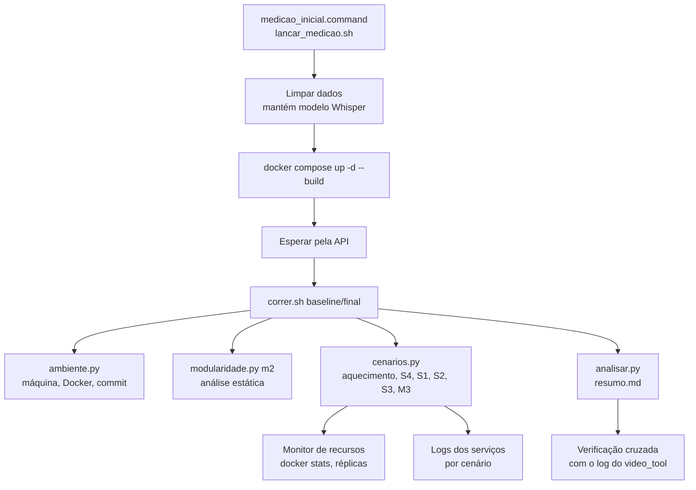

# Fluxo das Medições — o que os scripts fazem, passo a passo

Documento de apoio à defesa da Fase 2. Descreve **o fluxo** das medições (o que acontece e por que ordem), não o código. Os scripts foram gerados com apoio de IA e validados pela equipa (ver `PLANO_MEDICAO.md` e `CONTEXTO_E_DECISOES_FASE2.md`).

---

## Resumo em 6 passos

1. **Preparar um estado limpo:** apagar os dados da instância anterior (contas, projetos, ficheiros, filas), mantendo só o modelo Whisper já descarregado.
2. **Lançar a solução:** `docker compose up -d --build` e esperar até a API responder.
3. **Registar o ambiente:** máquina, processador, recursos do Docker, commit e `git status` (para provar que o código não foi alterado).
4. **Medir a modularidade (estático):** analisar o código e a configuração, sem correr nada (M2).
5. **Correr os cenários:** aquecimento → S4 → S1 → S2 → S3 → M3, cada um com 5 repetições, como um utilizador real a usar a aplicação pela API pública; em paralelo, amostrar recursos e, no fim de cada cenário, guardar os logs dos serviços.
6. **Resumir e verificar:** calcular mediana, mínimo, máximo e IQR de cada métrica; confirmar os tempos com os logs do próprio `video_tool`.

---

## 1. Lançador (`medicao_inicial.command` / `medicao_final.command` → `lancar_medicao.sh`)

1. Escreve no log a hora, o commit e a versão do Python.
2. Se o Docker Desktop não estiver a correr, abre-o e espera.
3. **Limpeza (decisão D12):** `docker compose down --remove-orphans` e apaga os volumes de dados `picturas_{image,project,rabbitmq,seaweedfs,subscription,user}_data`. Mantém `picturas_whisper_models`.
4. `docker compose up -d --build`: constrói as imagens e arranca todos os serviços.
5. Espera que a API responda: tenta um login com uma conta inexistente a cada 5 s até receber uma resposta 4xx (sinal de que nginx, gateway e `users` estão prontos). Depois espera mais 60 s, para os workers se ligarem ao RabbitMQ.
6. Corre `correr.sh baseline` (ou `final`) com `caffeinate`, para o Mac não adormecer.
7. Tudo o que aparece no Terminal fica em `<fase>/terminal.log` (ex.: `baseline/terminal.log`).

## 2. `correr.sh` (o mesmo para a medição inicial e para a final)

1. Cria um ambiente Python isolado (`.venv`) com as bibliotecas fixadas em `requirements.txt`.
2. `ambiente.py` → `ambiente.json`.
3. `modularidade.py m2` → `m2/m2_modularidade.json`.
4. `cenarios.py todos --reps 5` → um CSV por cenário, amostras de recursos e logs (registo em `execucao.log`).
5. `analisar.py` → `resumo.md` e `resumo.json`.

## 3. O percurso de cada trabalho medido

Cada trabalho é feito por um **utilizador de teste próprio**, pela interface pública (`https://localhost:8080`), exatamente como o frontend:

| Passo | Pedido | Conta para o tempo? |
|---|---|---|
| 1. Registo | `POST /api-gateway/users/` (conta premium) | Não |
| 2. Login | `POST /api-gateway/users/<email>/login` → token JWT | Não |
| 3. Criar projeto | `POST /api-gateway/projects/<user>` | Não |
| 4. Carregar o vídeo | `POST …/video` (multipart), com a versão atual do projeto | Não |
| 5. Definir o pipeline | `POST …/tool` (ex.: brilho 1,2 ou legendas) | Não |
| 6. Ligar ao WebSocket | Socket.IO com o token do utilizador | Não |
| 7. **Apply** | `POST …/process` → resposta 201 = **instante "submetido"** | **Início da medição** |
| 8. Primeiro progresso | Evento `video-progress` do projeto = **instante "início"** | Mede a espera |
| 9. Resultado | Evento `process-update` = **instante "fim"** | Fim da medição |
| 10. Limpeza | Desliga o WebSocket, apaga o projeto e a conta | Não |

- **Tempo de espera** = início − submetido (quanto tempo o vídeo ficou na fila).
- **Tempo de conclusão** = fim − submetido (o que o utilizador sente).
- Um evento `process-error`, ou mais de 30 min sem resposta, conta como falha e fica registado (nada é apagado).

## 4. Os cenários (ordem de execução)

| # | Cenário | O que o script faz em cada repetição |
|---|---|---|
| 0 | **Aquecimento** (descartado) | Uma legendagem e um brilho, para descarregar o modelo e aquecer caches |
| 1 | **S4** — vídeo sozinho | Brilho nos vídeos de 10 s, 30 s e 150 s, um de cada vez |
| 2 | **S1** — bloqueio pela legendagem | (a) brilho no vídeo de 10 s sozinho (controlo); (b) pede a legendagem do vídeo de 177 s, espera que comece e pede o brilho no vídeo de 10 s para outro utilizador |
| 3 | **S2** — carga concorrente | 1, 2, 4 e 8 utilizadores pedem o brilho **no mesmo instante** (uma barreira sincroniza as threads) |
| 4 | **S3** — adaptação à carga | 30 s de calma → rajada (8 brilhos + 1 legendagem ao mesmo tempo) → 120 s de calma, sempre a amostrar recursos |
| 5 | **M3** — isolamento de falhas | Pede a legendagem; aos 55 % de progresso (já na etapa da legendagem, D33), 4 utilizadores pedem brilhos; 5 s depois **termina à força** o serviço que faz a legendagem (`docker compose kill -s SIGKILL`) e volta a arrancá-lo 5 s depois |

Entre repetições há uma pausa de 10 s.

## 5. O que corre em paralelo com cada cenário

- **Monitor de recursos** (thread): em cada amostra lê o número de réplicas de cada serviço (`docker ps`), a CPU e a memória de cada contentor (`docker stats`) e tenta ler as filas do RabbitMQ. Na prática cada amostra levou cerca de 7 s e as filas não devolveram dados (ver `PLANO_MEDICAO.md`, secção 8).
- **Logs dos serviços:** no fim de cada cenário, guarda `docker compose logs --timestamps` do `video_tool` e do `projects` desse período (`logs_<cenário>.txt`).

## 6. Análise (`analisar.py`)

1. Lê os CSV de cada cenário.
2. Para cada métrica calcula **mediana, mínimo, máximo e IQR** das 5 repetições.
3. Calcula a **fila e o paralelismo a partir dos instantes de cada trabalho**: quantos vídeos estavam à espera (submetidos e sem progresso) e quantos em processamento (entre o início e o fim − 1 s) em cada momento. Não depende de como a fila é implementada, por isso compara bem o antes e o depois.
4. Escreve `resumo.md` (tabelas) e `resumo.json`.

## 7. Verificação (como sabemos que os números são reais)

1. Os valores saem só dos scripts; nenhum é escrito à mão.
2. O `ambiente.json` regista o commit e mostra que o código da aplicação não foi alterado.
3. **Verificação cruzada:** o `video_tool` escreve no seu log, por vídeo, `[video] … ok … t=XXs`. Em todos os cenários, o número de vídeos concluídos no log é igual ao dos CSV, e os tempos de processamento diferem menos de 0,4 s por trabalho.
4. Qualquer elemento pode repetir um cenário (`python scripts/cenarios.py s1 --reps 1 --out verificacao`) e comparar.

## 8. Medição final

Mesmo lançador, mesma limpeza, mesmos scripts, mesmos vídeos, mesma máquina e mesmos recursos do Docker. Só muda o código da solução (depois do *refactoring*) e, se a legendagem passar para outro serviço, as opções `--servico-legendas` (M3) e `--servicos-log`.
